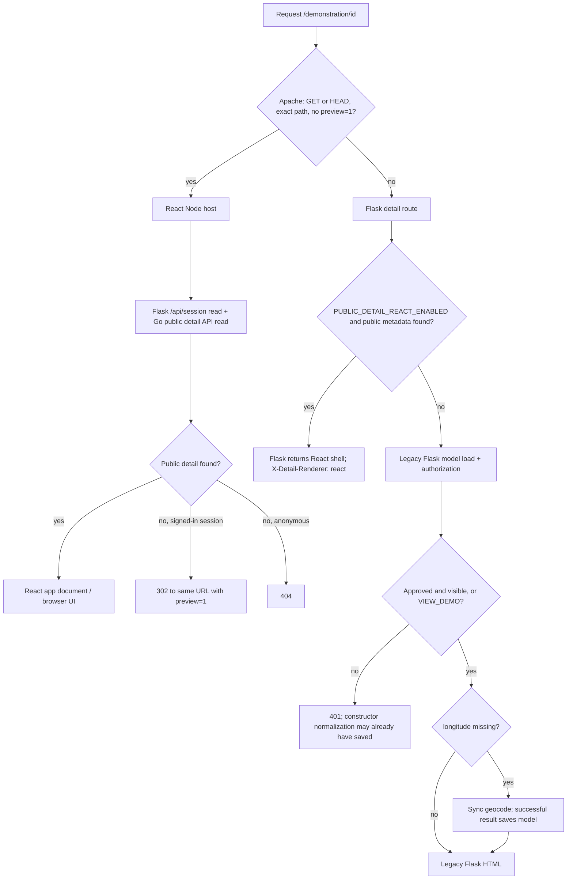

# Issue #1172: approval-clear write-path inventory

## Finding

Production history establishes an approved → unapproved → approved sequence for the event, with approved decision metadata surviving the unapproved state. It does not identify the write that cleared `approved`. The later `last_modified` value is not a reset audit record: several writes set it, and some direct writes do not. The sanitized history records are in [`tests/fixtures/email_approval_overwrite_1172.json`](../../tests/fixtures/email_approval_overwrite_1172.json).

`Demonstration.save()` can persist `approved` from its in-memory snapshot. `to_dict()` serializes that modeled field; `save()` `$set`s the serialized model on an existing document; `moderation_decision` is not modeled and remains untouched ([Demonstration.py:795–840](../../mielenosoitukset_fi/utils/classes/Demonstration.py), [Demonstration.py:698–740](../../mielenosoitukset_fi/utils/classes/Demonstration.py)). `from_dict()` defaults missing `approved` to false ([Demonstration.py:915–999](../../mielenosoitukset_fi/utils/classes/Demonstration.py)). A stale or incomplete model can therefore clear approval while retaining approval metadata.

## Existing-document paths capable of clearing approval

| Path | Mutation and trigger | Decision metadata / timestamp | Fit for this event |
|---|---|---|---|
| Admin case escalation | `admin_case.demo_escalate` writes `approved=false,rejected=false` for a linked `new_demo` case ([admin_case_bp.py:1044–1087](../../mielenosoitukset_fi/admin/admin_case_bp.py)). | Leaves `moderation_decision`, `hide`, and demo `last_modified` unchanged. | Possible for a case-linked, future, nonrecurring event. Its mutation alone cannot account for a newly advanced `last_modified`; no case-write attribution was found. |
| Admin edit form | `collect_demo_data` reads checkbox as `request.form.get("approved") == "on"`, so missing/unchecked means false ([admin_demo_bp.py:4482–4580](../../mielenosoitukset_fi/admin/admin_demo_bp.py)). An authorized edit saves that value through `Demonstration.save()`; a non-authorized edit replaces it with the current DB value ([admin_demo_bp.py:4097–4165](../../mielenosoitukset_fi/admin/admin_demo_bp.py)). | Save updates `last_modified`; modeled approval is written, decision metadata is retained. A stale open form can submit its old unchecked state; a concurrent decision after the handler's read can also make the model stale. | Plausible. No edit history/audit was found that proves this handler ran. Current code reads the document when handling POST, so stale client form or a concurrent write is required; no stale model is established by production evidence. |
| Generic model save | `Demonstration.save()` writes all modeled fields. Direct save callers include the admin edit above, MCP content update, recurring child update, geocode preview path, and model merge helpers. | Sets `last_modified`; leaves unmodeled decision metadata. | Mechanism confirmed, invocation unknown. `mcp_admin_bp._update_demo` rejects an `approved` patch but reads the document then saves a reconstructed model ([mcp_admin_bp.py:663–725](../../mielenosoitukset_fi/mcp_admin_bp.py)); a concurrent approval between read and save could be lost. `load_by_id()` calls `from_dict()` with normalization writes enabled ([Demonstration.py:856–915](../../mielenosoitukset_fi/utils/classes/Demonstration.py)); changed date/time normalization, a parent, rejection, or relative preview path triggers constructor save ([Demonstration.py:265–277, 358–365, 427–435](../../mielenosoitukset_fi/utils/classes/Demonstration.py)). The final attribution section establishes that this event's time fields did trigger normalization in the 11:41:50 interval; request attribution remains inferred. |
| Admin recurring-child bulk update | The field map includes `approved`; selected parent fields are `$set` on children ([admin_recu_demo_bp.py:51–68, 955–1025](../../mielenosoitukset_fi/admin/admin_recu_demo_bp.py)). | Copies approval only; does not touch decision metadata or `last_modified`. | Ruled out: event has no parent. |
| Recurring refresh | Existing generated child may be hydrated and saved by `update_self_from_recurring`; parent refresh saves recurring-parent data ([repeat_v2.py:430–473](../../mielenosoitukset_fi/scripts/repeat_v2.py)). | Child model save writes modeled approval and leaves decision metadata. | Ruled out for this event: it is nonrecurring and parentless. |
| Past-event marking | Past events are hydrated, marked `in_past`, and saved ([in_past.py:130–143](../../mielenosoitukset_fi/scripts/in_past.py)). | Model save writes approval and last_modified; leaves decision metadata. | Ruled out: event date is 2026-11-19 and `in_past=false` at inspection. |
| Suggestion application | An authorized operator can select a stored suggested field; the apply handler `$set`s the selected key ([admin_demo_bp.py:900–958](../../mielenosoitukset_fi/admin/admin_demo_bp.py)). | Leaves decision metadata and `last_modified` untouched. | The normal suggestion form only creates content fields and excludes approval ([basic_routes.py:3560–3571](../../mielenosoitukset_fi/basic_routes.py)), so this needs a nonstandard stored suggestion. No suggestion evidence ties it to this event; the handler also does not set `last_modified`. |
| Duplicate cleanup script | `scripts/rem_dub.py` finds duplicate title/date/hour/city rows and sets `approved=false,hide=true` ([rem_dub.py:11–41](../../mielenosoitukset_fi/scripts/rem_dub.py)). | Leaves decision metadata and `last_modified`; also sets hide true. | Poor fit: inspected history has `hide=false` before and after the reset. |
| Admin merge | The merge form can choose `approved` from another selected document; the primary is fully replaced with the merged snapshot ([admin_demo_bp.py:102–123, 2713–2837](../../mielenosoitukset_fi/admin/admin_demo_bp.py)). | Carries primary’s `moderation_decision` unchanged while replacing `approved`; updates `last_modified`. | Possible only in a multi-event merge with a false-valued source. No merge backup/audit evidence ties it to this event. |
| Automated duplicate-submission merge | Every 5 minutes, `process_submit_notifications` calls `merge_duplicate_submissions` ([definitions.py:133–139](../../mielenosoitukset_fi/background_jobs/definitions.py), [process_submission_notifications.py:321–331](../../mielenosoitukset_fi/scripts/process_submission_notifications.py)). It groups visible exact duplicates by title, organizers, date, times, address, and city; chooses a primary; then `Demonstration.merge()` copies each non-`None` field from each duplicate into that primary ([merge_duplicate_submissions.py:33–69, 95–127](../../mielenosoitukset_fi/scripts/merge_duplicate_submissions.py), [Demonstration.py:606–634](../../mielenosoitukset_fi/utils/classes/Demonstration.py)). Boolean `False` is copied, so an unapproved duplicate can clear the primary’s approval. | Model save updates `last_modified`; moderation metadata from the primary stays untouched. | Plausible for any future nonrecurring visible event if an exact duplicate existed and the approved event was selected as primary. No duplicate group or merge audit proves this occurred. This is a scheduled candidate that fits the timestamp shape, not attribution. |
| Recurring duplicate merge | `repeat_v2.merge_duplicates()` calls the same model merge on recurring duplicates ([repeat_v2.py:509–521](../../mielenosoitukset_fi/scripts/repeat_v2.py)). | Model save updates `last_modified`; decision metadata stays untouched. | Ruled out by the event’s `recurs=false`, no parent, and absent recurring marker. |

## Paths that do not explain the observed state

- The decision service’s rejected transition sets `approved=false`, but also sets `moderation_decision.status="rejected"` ([decisions.py:20–25, 271–321](../../mielenosoitukset_fi/demonstrations/decisions.py)). That does not fit the surviving approved metadata.
- Content rollback explicitly excludes approval and moderation fields ([admin_demo_bp.py:1151–1229](../../mielenosoitukset_fi/admin/admin_demo_bp.py)). Merge-recovery replacement is guarded by equality with the merge result; it was not shown to run here ([rollback.py:18–42](../../mielenosoitukset_fi/demonstrations/rollback.py)).
- Demo creation paths set false only on inserts: public submission, MCP create, admin duplicate, and Go submission construction. They cannot update this existing event ([basic_routes.py:2330–2350](../../mielenosoitukset_fi/basic_routes.py), [mcp_admin_bp.py:635–660](../../mielenosoitukset_fi/mcp_admin_bp.py), [admin_demo_bp.py:2508–2546](../../mielenosoitukset_fi/admin/admin_demo_bp.py), [submission_input.go:197](../../go-api/submission_input.go)).
- Other enumerated demonstration updates affect only content/organizers, cancellation, city assignment, image, or notification fields. Go API source has no existing-demonstration approval update; its `approved=false` payload is submission creation only.

## Scope and limits

Targeted source searches covered Python demonstration collection writes, model `.save()` callers, approval assignments, migration/import/recurrence/rollback/merge paths, operational scripts, and Go API mutations. This is source capability inventory, not proof of production execution. Read-only production state ruled out the two scheduled candidates `in_past.py` and recurring refresh. Bounded production access/service logs supplied no write attribution. Exact writer, execution instant, and whether any stale model was used remain unknown. No application code or production data was changed.

## Apache correlation (read-only, 15 November 2026)

Inspected the current and `.1` production access logs for the main site and API host. Parsed each row's timezone and normalized to UTC. The 11:40:00–11:53:00 UTC window contained 758 parsed requests across those logs. A narrower 11:41:45–11:42:35 window was checked for event requests, admin routes, MCP and non-GET requests. Tokens and query strings were removed on the production host before output; client addresses, user agents and identities were not exported.

Selected sanitized rows:

| UTC | Method | Path | HTTP status |
|---|---|---|---|
| 11:40:22 | POST | `/api/admin/mcp/` | 401 |
| 11:40:31 | POST | `/api/admin/mcp/` | 401 |
| 11:41:50 | GET | `/demonstration/6af9880760b589b979d9c437` | 302, then 200 |
| 11:42:04 | GET | `/admin/demo/approve_demo_with_token/[REDACTED]` | 200 |
| 11:42:11 | POST | `/admin/demo/approve_demo_with_token/[REDACTED]` | 302 |
| 11:42:11 | GET | `/demonstration/6af9880760b589b979d9c437` | 200 |
| 11:42:12 | GET | `/api/demonstrations/6af9880760b589b979d9c437` (API host) | 200 |
| 11:42:12 | GET | `/api/demonstrations/6af9880760b589b979d9c437/attending` | 200 |
| 11:42:21 | GET | `/api/demonstrations/6af9880760b589b979d9c437/likes` | 200 |
| 11:52:19 | POST | `/admin/demo/accept_demo/6af9880760b589b979d9c437` | 200 |

The narrow window also contains successful analytics view/vitals POSTs with the event page as referrer. The broader window contains three token-link GETs at 11:52:08/12, consistent with the already-recorded reuse attempts. No admin edit or case escalation POST, or successful MCP request, appeared in the inspected broader window.

These logs support the request sequence around both approvals. They do not show request bodies, database mutations, background work, or the precise point within a request at which a write occurred. A 200 response does not prove the returned event state; request timestamps are not database execution timestamps. The failed MCP requests are not evidence of a successful mutation. Absence of a matching request in this bounded window cannot exclude an earlier in-flight request, an internal call or a background process. No person or specific writer is attributed by this correlation.

## Flask detail GET and reproduced race

## Renderer routing: verified production flow

Production Apache rules were read from `/etc/apache2/mielenosoitukset-react-ssr.conf`. For exact one-segment `/demonstration/<id>` requests, Apache proxies `GET` and `HEAD` to the React Node host unless query contains `preview=1`. Other methods and preview requests fall through to Flask's catchall proxy. The rule does not claim `/ics`, `/some`, or child paths. Active production config had `PUBLIC_DETAIL_REACT_ENABLED=true` (config mtime 2026-11-14 08:27:24 UTC); Apache rule mtime was 08:28:00 and Flask service started 08:28:19. Thus those values predate the incident. Deployment history showed no intervening release before the incident; current values alone would not establish historical state, but these timestamps do for this incident window.

The Node renderer does not itself check `VIEW_DEMO`; it knows only whether `/api/session` says authenticated. The preview request then reaches Flask, where `render_public_detail()` returns `None` for authenticated users with `VIEW_DEMO`, allowing the legacy page. For a public event sent to Flask (for example an explicit `preview=1`), Flask returns the React shell. Its `X-Detail-Renderer: react` header distinguishes this shell from legacy HTML. Normal Apache-proxied React responses had no such header in the live probe. React document rendering still depends on Flask session and Go API reads; it does not mean Flask was absent from the request chain.

### Decision matrix

“Model write” means the detail request can update the demonstration document. Flask analytics can separately update aggregate analytics. Geocoding is synchronous and only occurs in the authorized legacy model/render path when longitude is false. A successful coordinate lookup calls `Demonstration.save()`; a miss/error does not.

| Event/request state | Handler and result | Demo write / geocode |
|---|---|---|
| Approved, visible; Apache normal GET/HEAD | Apache → React Node; public Go read; React page. | No / no. |
| Approved, visible; Flask reached and flag on | Flask `render_public_detail()` → React shell, 200 (or recurring redirect). | No / no. |
| Approved, visible; flag off | Legacy Flask page; model load, then normal checks. | Constructor normalization may save; geocode if longitude missing. |
| Unapproved, rejected, or hidden; anonymous or authenticated without `VIEW_DEMO`; Apache normal GET | React Node public API returns not-found; anonymous gets 404. Authenticated session gets 302 `?preview=1`; Flask then returns 404 because no `VIEW_DEMO`. | Node path no / no. Preview Flask path may constructor-save before permission denial; no geocode. |
| Same nonpublic event; authenticated `VIEW_DEMO`, Apache normal GET | React Node redirects to `?preview=1`; Flask falls through to legacy page (200). | Constructor normalization may save; geocode if longitude missing. |
| Same nonpublic event; Flask reached directly, flag on | Metadata lookup hides it; authorized `VIEW_DEMO` falls through to legacy, others 404. | Unauthorized path may constructor-save before 404; authorized path can normalize-save and geocode. |
| Cancelled but approved and visible | Same as approved/visible. Cancellation changes rendered status, not public visibility. | Same renderer-specific behavior above. |
| Recurring child with publicly visible parent | React API resolves public child; React UI may redirect/display series according to route. Flask shell path redirects 301 to series. Legacy path redirects 301 after load. | React/shell no; legacy may normalization-save before redirect. No geocode after redirect. |
| Recurring child with nonpublic parent | Child visibility controls API/shell; no parent redirect unless parent itself is public. Legacy path uses child visibility/permission. | Same as applicable public/private row. |
| ObjectId, slug, running number | Go and Flask resolve ObjectId, alias, running number, then slug (with implementation-specific precedence). A nonpublic existing ObjectId does not resolve through another public alias in Go. | Depends on resolved record and renderer; identifier form alone does not write/geocode. |
| Missing title/description or incomplete optional metadata | Public visibility still depends on `approved`, `hide`, `rejected` types/values. React API fills/falls back for display metadata; malformed/unresolvable payload gives 404 or unavailable response. Flask shell uses fallback title/description. | React/shell no. Legacy may normalize-save or geocode based on model triggers/longitude. |
| Missing latitude/longitude, longitude false | React path does not geocode. Flask legacy rendering does, but only after authorization. | Authorized legacy path may save coordinates and all modeled fields; unauthorized path does not reach geocoding. |
| `?preview=1` | Apache → Flask. Public record with flag on returns React shell. Nonpublic record falls through; `VIEW_DEMO` gets legacy; others 404. | Public shell no. Legacy permissions and coordinate rules apply. |
| `detail_layout` query on legacy path | Flask legacy handler redirects to canonical URL and may set layout cookie. | It has already constructed model; constructor normalization may save. No geocode before this redirect. |
| Unsupported method or unmatched path | Apache catchall → Flask routing; unsupported methods produce Flask 405 or route-specific handling. `/some` is a separate legacy preview endpoint. | Route-specific; `/some` has its own geocode/save behavior. |

An API failure on the React route yields unavailable/503 behavior; invalid or absent public detail gives 404 (except a signed-in Node session first gets the preview redirect). These are not legacy fallbacks unless the resulting `?preview=1` request is separately sent to Flask. The Flask flag controls its handler only; it cannot override Apache's earlier proxy decision.

## Final historical attribution assessment — 15 November 2026

#### Timestamped evidence

All displayed times below are UTC. Apache's configured format records `%t` with an explicit `+0000` offset and no duration. Flask's `utcnow()` uses UTC then stores a naive UTC datetime; MongoDB BSON dates are UTC. `journalctl` was queried with UTC bounds. The host currently reports UTC and NTP synchronized; no time-sync journal entries were retained for the incident interval, so historical clock skew cannot be measured.

| UTC | Evidence | What it establishes / does not establish |
|---|---|---|
| 11:41:43 | Apache: `GET /admin/demo/` → 200. | The page requires login, admin access, and `LIST_DEMOS` ([admin_demo_bp.py:1858–1863](../../mielenosoitukset_fi/admin/admin_demo_bp.py)). Six seconds later, the detail GET has this page as referrer. This strongly suggests an authenticated moderation browser, but Apache did not record a session identity, so it does not prove the same user had `VIEW_DEMO`. |
| 11:41:50 | Apache line 20903: normal detail `GET` → 302, referer `/admin/demo/`. | Active Apache rule sends normal exact-path GETs to React. React uses the signed-in session plus the Go public API result to redirect an authenticated visitor for a private event to `?preview=1`. This request did not enter Flask's detail route. |
| 11:41:50 | Apache line 20986: same detail path with `?preview=1` → 200. | Apache excludes `preview=1` from its React proxy, so Flask received it. The row was appended after the 11:42:11 token POST, redirect GET, and 11:42:12 API traffic. Apache logs at request completion, with no `BufferedLogs` directive configured; this supports later completion, but line order gives no exact completion time and cannot prove when a DB write happened. The 200 may be legacy HTML or Flask's React shell; the log format omits `X-Detail-Renderer`. |
| 11:41:50.362 | Token approval history's `old_demo.last_modified`; `approved=false`, coordinates absent. The preceding history snapshot (10:25:23.929) had `start_time="12:00"`, `end_time=""`; the token pre-image had `start_time="12:00:00"`, `end_time=null`. | Those exact changes match deployed constructor normalization, which sets `save_flag` and calls `save()`. This strongly explains the timestamp as a model normalization save. The preview GET is the only observed request for this event in that second and calls this model loader if it reaches legacy handling. No Mongo operation record links the save to that request, so origin remains inferred. |
| 11:42:04 | Token confirmation `GET` → 200. | Confirmation page loaded before the decision; no approval write yet. |
| 11:42:11.585 | Token approval's `moderation_decision.at` and `new_demo.last_modified`; `approved=true`, coordinates still absent. History snapshot was written at 11:42:11.638. Audit actions: `decision_tokens_revoked` at .626, `approve_demo` at .652, `token_used` at .698. | The token decision succeeded. The history snapshot is a reliable before/after record for this decision, not a general audit of every model save. |
| 11:42:11–12 | Token POST → 302; its no-preview detail redirect GET → 200; Go detail API read → 200 at 11:42:12. | Apache sends the no-preview GET to React. Go detail resolution/cache reads do not update demonstrations. This GET cannot take Flask's legacy geocode-save path. |
| 11:42:20.628 | Later manual approval's `old_demo.last_modified`; `approved=false`, `moderation_decision.status=approved`, and both coordinates now populated. | Establishes the inconsistent state and that coordinates became populated after the token snapshot. It does **not** timestamp the DB update. `Demonstration.save()` assigns `last_modified` before `find_one()` and `update_one()`, so the stored value precedes, but does not precisely mark, the write. |
| 11:52:08–12 | Reused token attempts; audit records `token_reuse_attempt`. | No new approval decision in these attempts. |
| 11:52:19.798–.862 | Manual `accept_demo` POST → 200; decision timestamp/new `last_modified` .798; history `.845`; audit `approve_demo` .862. | Manual approval restored `approved=true`; source became `legacy_api`. Coordinates were already populated in the pre-image. |

The access log line order is a completion/logging-order clue, not an elapsed-time measurement. Its `%t` is the request receive time, rounded to one second. The active log format contains no `%D`/`%T`; it logs no response header that identifies the Flask branch. `X-MF-Request-ID` is configured as an output field, but the detail path does not create one. No per-request correlation ID joins Apache, Flask, geocoder, and MongoDB.

#### Coordinate history follow-up (read-only, 15 November 2026)

A bounded read-only query of this demonstration's retained `demo_edit_history` records and current document found:

- The 10:25 history snapshots do not contain latitude/longitude fields. The 11:42:11.638 token-approval history pre-image explicitly has both fields `null`; its post-image still has both `null`.
- The next retained history snapshot, the 11:52:19.845 manual-approval record's pre-image, has both coordinate fields populated. The 12:00:31.390 and 13:31:27.739 history snapshots and the current document retain the same coordinate pair.
- No retained history snapshot lies between the token approval and manual approval. Thus the first *observed persisted state* with coordinates is bounded to after 11:42:11.638 and by 11:52:19.845. The intervening document's `last_modified=11:42:20.628` narrows a candidate model-save time only; it is not a write audit or proof that the fields were committed at that instant.

The values are stored as strings, matching the `geocode.maps.co` helper's output format. Their geographic plausibility does not identify their source. No retained provider response, query, or dashboard record is available to compare them to the address, and no new geocoding request was made. We therefore cannot establish that these exact values came from the provider for this demonstration.

This coordinate transition materially strengthens the preview hypothesis: the preview path is the identified public request path that conditionally geocodes a missing-longitude demonstration and saves the returned coordinates on its already-loaded model. The `.628` timestamp follows the successful token decision and fits that second save. It still does not prove which writer first stored the fields. Admin form submissions and generic model saves (including edits or merges) can persist coordinates too; the admin geocode API itself returns candidate values but does not save the demonstration. No matching admin write request, merge evidence, or scheduled geocoding job was found, but those absences do not eliminate unlogged/internal writers.

#### Newly established two-save sequence

Read-only history shows the event still had `start_time="12:00"` and `end_time=""` in records at 10:25. Its 11:42:11 approval pre-image had `"12:00:00"` and `null`. The deployed `a76090346120cea6d92d065b3ffa05d4f4d8fd99` source converts `HH:MM` to `HH:MM:SS`, treats an empty time as missing, sets `save_flag` when either value changes, and calls `save()` once at the end of construction ([deployed Demonstration.py:261–277, 434–435, 1031–1052](https://github.com/mielenosoitukset-fi/mielenosoitukset_fi/blob/a76090346120cea6d92d065b3ffa05d4f4d8fd99/mielenosoitukset_fi/utils/classes/Demonstration.py)). `load_by_id()` calls `from_dict()` with normalization saves enabled. `save()` assigns `last_modified=utcnow()` before its PyMongo `find_one()` and `$set` update.

This provides a concrete, source-matched explanation for the `.362` timestamp: a constructor normalization save likely ran at 11:41:50.362, before geocoding. It also explains why that first save left coordinates absent and `approved=false`: those were the model's loaded values. If the `?preview=1` request caused it, Flask had passed the private-event gate and loaded the legacy model. The prior `/admin/demo/` response and the preview response support that path, but no session ID, worker log, or Mongo operation record proves the association.

One preview request can perform **two** model saves. After `load_by_id()` normalizes and saves, the Flask route checks `longitude`; if absent, it synchronously calls the geocoder. A successful result updates coordinates and calls `demo.save()` again ([deployed basic_routes.py:3088–3101, 3211–3216, 3782–3787](https://github.com/mielenosoitukset-fi/mielenosoitukset_fi/blob/a76090346120cea6d92d065b3ffa05d4f4d8fd99/mielenosoitukset_fi/basic_routes.py)). That same in-memory object retains `approved=false` from before email approval. A second save would set coordinates and `last_modified=11:42:20.628` while writing stale approval and leaving unmodeled `moderation_decision` intact. This exactly matches the later manual-approval pre-image. It is a strong historical fit, not a captured Mongo operation.

#### Preview branch and permission evidence

Production's `?preview=1` request definitely reached Flask. If it read the event while still unapproved, `render_public_detail()` could only fall through for an authenticated user with `VIEW_DEMO`; otherwise it would return 404. The model normalization evidence makes that legacy load path likely, and, if the preview request caused the normalization write, it establishes that `VIEW_DEMO` passed. The log itself does not bind the request to a user or record the route branch. A delayed Flask lookup after approval could instead return the React shell, but that would not explain the matching normalization save. Thus legacy rendering is **strongly inferred**, not directly logged.

The request received at 11:41:50 and its access-log row appears after the token POST/redirect and 11:42:12 API traffic. The route's `.628` timestamp is at 11:42:20.628, after the successful token decision's `.585` timestamp. These support a later geocode save; neither Apache's start timestamp nor append order establishes the exact outbound request or database-write instant.

#### Geocoding provider and retained telemetry

The exact pre-incident deployed source uses `https://geocode.maps.co/search` through Python `requests.get`, passing the demonstration's address, city, and country; an optional API key is added from configuration. Timeout is 10 seconds for connect/read inactivity, not a total wall-clock deadline ([deployed geocode.py:18–87](https://github.com/mielenosoitukset-fi/mielenosoitukset_fi/blob/a76090346120cea6d92d065b3ffa05d4f4d8fd99/mielenosoitukset_fi/utils/geocode.py)). No address, coordinates, or key were sent to the provider during this investigation.

No retained application/provider request log, HTTP-client hook, distributed trace, or provider-dashboard connection is available. The helper logs failures and empty results, but logs no successful query or response; the Flask journal had no geocode message in the interval. The service's current environment has no proxy variables; no local egress proxy, proxy log, or firewall packet log was found. Kernel journal had zero matching egress/firewall records. The attached Prometheus data has node-level aggregate network counters and health probes only (`job=node`); incident-window samples do not identify a process, destination, URL, or request. No Sentry/OpenTelemetry/Jaeger/Datadog-style agent or application instrumentation was found. These sources cannot establish whether the call occurred, its query input, or its response values. No provider dashboard was accessible through connected tools or configured credentials.

#### Backup and database evidence availability

The latest usable Mongo archive in `/var/backups/mielenosoitukset` predates the incident (14 Nov). The scheduled 15 Nov core backup failed at 02:34 UTC and the weekly full backup failed at 03:31 UTC; no 15 Nov archive was produced. Older backups cannot show the 11:42 update. No restore was attempted: it would not recover a missing incident-time operation log, and the 10:25 history already establishes the earlier time values.

MongoDB was standalone, so no replica oplog exists. `system.profile` has zero entries in the incident window; its retained records end in August, and current profile level is 0. MongoDB's normal log has no CRUD records. The Flask service journal has no request ID or worker identity. The generic `print()` in `Demonstration.save()` includes no document ID; stdout is journal-bound but `PYTHONUNBUFFERED` is absent, so missing print output is not reliable evidence that no save ran. We did not enable profiling, alter logging, restart services, or restore data.

#### Model write mechanics at deployed revision

The last production deployment before the incident was commit `a76090346120cea6d92d065b3ffa05d4f4d8fd99` (14 Nov 22:47 UTC); next successful deployment followed the incident. Its `Demonstration.save()` matches the inspected source ([Demonstration.py:795–843](../../mielenosoitukset_fi/utils/classes/Demonstration.py)):

1. Set `self.last_modified = utcnow()`.
2. Serialize the model with `to_dict()`; `BaseModel.to_dict()` copies `self.__dict__`, which includes `approved` ([BaseModel.py:29–55](../../mielenosoitukset_fi/utils/classes/BaseModel.py); [Demonstration.py:698–746](../../mielenosoitukset_fi/utils/classes/Demonstration.py)).
3. Check the document with `find_one()`, then issue `update_one({'_id': self._id}, {'$set': data})`.

The write is not compare-and-set: selector checks only `_id`. It can overwrite concurrent `approved` with the model snapshot. It does not serialize `moderation_decision`; that metadata therefore survives. The model does not persist `rejected` as a field in this save. It updates modeled content fields and `last_modified`, not a full-document replacement. There is no version check or operation ID.

The exact token pre-image had date `2026-11-19`, start `12:00:00`, end `None`, no parent, `rejected=false`, and no preview image. These values do not trigger the constructor's date/time normalization, parent, rejection, or preview-image save conditions ([Demonstration.py:261–277, 358–365, 427–435](../../mielenosoitukset_fi/utils/classes/Demonstration.py)). This weighs against an automatic `from_dict()` normalization write for that snapshot. The route's separate geocode save remains code-supported: if longitude is false, `fetch_geocode_data()` calls the geocoder and calls `demo.save()` only when coordinates are returned ([basic_routes.py:3211–3216, 3782–3787](../../mielenosoitukset_fi/basic_routes.py); [geocode.py:24–87](../../mielenosoitukset_fi/utils/geocode.py)).

#### Audit, logs, and competing writers

Production read-only queries found six `demo_edit_history` rows for this event: three earlier rows, token approval at 11:42:11.638, manual approval at 11:52:19.845, and a later update at 12:00:31.390. No history row records the reset. The `diff` field is a placeholder (`None`); history is written only by workflows that explicitly call `save_demo_history()`/`record_demo_change()` ([audit.py:57–74, 122–145](../../mielenosoitukset_fi/demonstrations/audit.py)). Generic `Demonstration.save()` does not call them.

There were 19 `demo_audit_logs` entries. The token decision actions are present; next action after `token_used` at 11:42:11.698 is `token_reuse_attempt` at 11:52:08.437. No reset action exists. Apache showed no admin edit/case POST, successful MCP mutation, or other non-analytics write request in the 11:41:45–11:42:30 window. This excludes those observed HTTP requests, not internal code or unlogged background work. Existing scheduler/log review found no duplicate/merge run overlapping the incident; the event had no duplicate/merge evidence.

The Flask service journal had no event-ID or geocoder message in the incident window. Successful geocoding is not logged by this code. MongoDB's normal log had no CRUD record for the window. The server is standalone: no replica oplog is available. `system.profile` exists but has no entries from 11:41:30–11:53:30 on 15 November; its 370 retained records end on 20 August. Current profiling level is 0; historical level cannot be reconstructed from these records. We did not enable profiling or change production logging.

| Candidate | Evidence for | Evidence against / missing | Assessment |
|---|---|---|---|
| Flask preview constructor normalization, then geocode save on same stale model | The 10:25 history values normalize exactly into the 11:42 token pre-image; `.362` falls in the preview request's received second. The same route then sees missing longitude. Later coordinates and `.628` match its successful geocode-save path. The whole-model `$set` preserves `moderation_decision` but can restore `approved=false`. | No operation log links either save to this request; no provider result log, session identity, or worker trace. Another loader/background writer could perform normalization; another writer could populate coordinates. | **Strongly supported hypothesis. Very likely, not confirmed.** |
| Constructor normalization alone | Deployed code can explain `.362` and normalized time fields. | It ran before token approval and coordinates remained absent; that save alone cannot explain the later approved-to-false overwrite or coordinate transition. | Likely explains earlier write, not the reset by itself. |
| Admin edit or other generic model save | A stale edit/model can `$set` `approved=false`, preserve decision metadata, update `last_modified`, and potentially write coordinates. | No matching edit POST or history/audit action; no surviving request/write ID. Coordinates make this mechanically possible, but no evidence shows an edit. | Possible, less supported than preview two-save sequence. |
| Admin/case escalation | Case escalation can clear `approved` and retain moderation metadata. | That direct update does not set `last_modified` or coordinates; no matching case/edit request or audit entry. It would need another write to explain the rest of the pre-image. | Poor fit as sole writer. |
| Manual or automated merge | A merge can copy false approval and coordinates while retaining the primary's moderation metadata and changing `last_modified`. | No merge backup/audit, duplicate relationship, or exact duplicate group was found; scheduled overlap was not observed. Lack of a logged run alone does not exclude internal work. | Possible, but little production support. |
| Duplicate cleanup / rejection decision | Both can set `approved=false`. | Cleanup also sets `hide=true` and leaves `last_modified`/coordinates; rejected transition changes moderation status. Observed state contradicts these effects. | Poor fit / inconsistent. |
| Go detail API GET | It occurred after token approval. | Source uses public Mongo reads/cache; no write operation. | Ruled out for this observed GET. |
| MCP/API mutation or retry | Direct update paths exist. | No successful MCP or relevant non-analytics API POST appears in the inspected window. | No observed HTTP support; hidden/internal caller not excluded. |

#### Offline reproduction

Updated [test_demo_approval_get_race.py](../../tests/test_demo_approval_get_race.py) to exercise the Flask `?preview=1` leg. A mocked geocoder pauses after the legacy route loads `approved=false`; token approval then commits; the preview resumes and saves. Assertions verify `approved=true` before resume, then `approved=false`, unchanged approved token decision metadata, returned coordinates, later model `last_modified`, and no additional edit-history row for the generic save. The focused suite passed: 24 tests. `TEST_MONGO_URI` was unset, so pytest used its unique temporary local test database; geocoder was mocked. This demonstrates feasibility only.

#### Final confidence classification

- **Confirmed historical root cause:** none. No retained Mongo operation record directly names the writer and request.
- **Strongly supported hypothesis:** the Flask `?preview=1` request loaded the old model, normalized time fields and saved at `.362`, then geocoded missing coordinates and saved the same stale model at `.628` after token approval. This explains both timestamp transitions, coordinate appearance, and retained approval metadata. Coordinate history now shows absence at the token snapshot and presence by the manual-approval pre-image, strengthening this fit. Classification: **Very likely — strongly supported, not proven.**
- **Unresolved:** whether the two saves came from this exact request; whether the geocoder returned the stored coordinates; the Flask worker and response renderer; and exact Mongo commit times. Other internal/background writers cannot be categorically excluded.

The surviving evidence strongly favors the preview/geocoding path, but does not meet the direct-attribution standard. Apache gives receive time and log order, not elapsed time or a DB correlation ID. The MongoDB oplog is unavailable; profiler records do not cover the incident; backups do not cover it; MongoDB logs contain no CRUD audit. Definitive attribution required a per-write Mongo audit/change record or structured save log correlated to a request/job ID, plus a geocoder attempt/result record carrying that same opaque ID. Provider logs alone would not identify the Flask caller without this join. Those records were not collected or are no longer retained.

#### Minimal future attribution proposal (not implemented)

At each demonstration write boundary, emit a structured before/after record with demonstration ID, writer/function name, request or job correlation ID, UTC timestamp, changed field names and approval values, and Mongo matched/modified result. Do not include tokens, contact details, or addresses. Propagate an opaque request ID through Apache, Flask, and downstream work. Keep geocoder success/failure status linked to that ID without logging its query. This needs maintainer approval before implementation. Do not enable Mongo profiling or invasive production logging as part of this investigation.
